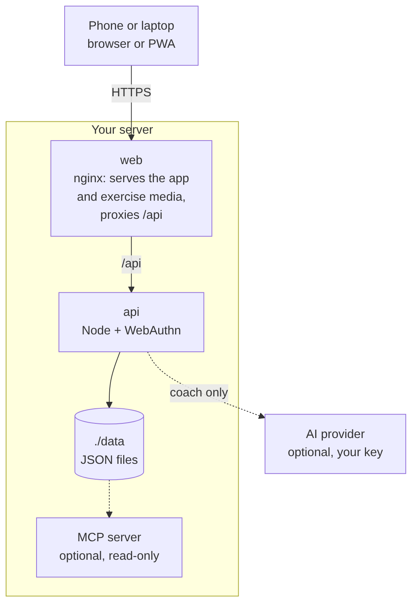
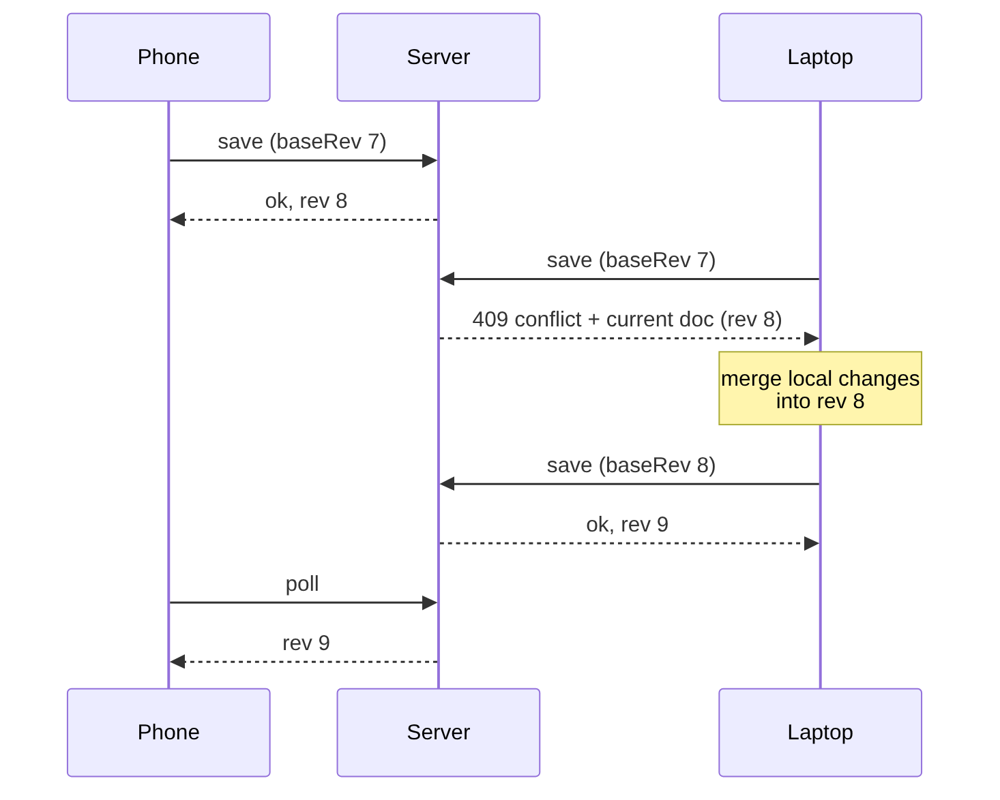

# URQENIX

A free gym and body-weight tracker you host yourself.

URQENIX is a modified version of [openGym](https://github.com/DuarteSantos8/openGym) by Duarte
Santos, based on openGym v1.4.4, and is licensed under the [GNU AGPL v3.0](LICENSE) like the
original. It is a separate project, not run or endorsed by openGym.

## Why URQENIX

Most workout apps keep your data on their servers, push you towards a subscription, or vanish
when the company does. URQENIX runs on your own box, keeps your data in a folder you control, and
is yours to fork. It still behaves like a modern app: installable on the home screen, passkey
sign-in, works offline, syncs between your phone and your laptop.

No account on someone else's server, no subscription, no ads, no telemetry. One
`docker compose up` and it's running.

## Features

**Planning**

- A routine per weekday over a library of **over 5,600 exercises** with animated demos, searchable and
  browsable by muscle on a body map. Filter by the equipment you own.
- Four starter plans (Push/Pull/Legs, Upper/Lower, Full Body, 5×5) that load as ordinary,
  editable routines.
- Every session on the Plan page and today's on Home carries a tiny body map with the muscles it
  works lit up, so you know Leg Day is legs before you open it.
- Move a session to another day without touching the weekly plan. The week starts on Monday or
  Sunday, your choice.
- Or skip the weekdays altogether: a **rotation** (A, B, C, A, ...) where the next session is
  simply the next one you haven't done, however the week went.
- Supersets, warm-up sets, drop sets and rest-pause, timed exercises (planks, hangs, carries),
  cardio by time and speed, rest time per exercise, planned deloads.
- Your own exercises, with your own photo, GIF or short video. Location data is stripped on the
  device before upload.

**Training**

- Guided sessions: today's workout starts itself, weights are pre-filled from last time, a rest
  timer runs between sets, PRs are detected as you go. On a rest day it tells you when the next
  session is.
- A quiet workout screen: one menu per exercise, the set number as the set's own menu, card or
  list view. Switches in Settings bring the old button rows back if you liked them.
- Optional effort column as RIR or RPE, colour-coded, with a plain-language line per level.
- Plate math for barbell, EZ bar, trap bar and Smith machine, worked out from the plates you own.
  Train in more than one place? Each gym keeps its own plates, dumbbells, bars and machine stacks,
  and the phone can switch to the gym you just walked into.
- Bodyweight exercises know they carry no load: log reps, add a dip belt if you use one.
- Per-side reps for lunges and single-arm work, the screen stays awake while you train, and a
  rest-timer alert can flash the screen for loud gyms.
- Swipe a set left to delete it (with Undo) or right to copy it. Pyramid sets with their own reps
  and rest per set, and a scroll wheel for any rest time up to 15 minutes, or no timer at all.
- Machine taken? A planned backup exercise swaps in with one tap and keeps the slot's sets and reps.
  Machines can carry their real weight stack, odd steps included, and progression sticks to it.
- The session's volume runs live at the end of the progress bar.

**Progress**

- Progression rules per routine or per exercise: linear, Greyskull LP, double progression through a
  visible rep range, triple progression (reps, then sets, then load), or adding time. Each target explains why it is that number; missed reps never
  add load, stalls trigger a deload.
- Estimated 1RM per exercise with its own curve, Structural Balance ratios (Poliquin, Thibaudeau,
  ATG), a year-long activity heatmap.
- A muscle map in three modes: where your volume went, what is still recovering, and what has gone
  untrained.
- Body-weight chart against a goal line, with your weekly rate and an optional lose, gain or hold
  range, and progress photos on a timeline with a before/after slider.
- Lifts as a percentage of body weight, and a running total of everything you've ever lifted.
- Edit any saved workout after the fact, log one you did on paper, or move it to the right date.
  Records are re-read from the corrected history.

**Accounts and data**

- Passkeys (Face ID, Touch ID, fingerprint) with per-profile data synced across devices. Password
  sign-in can be switched on per instance; new devices pair with a one-time code or QR.
- Two devices editing at once merge field by field instead of overwriting each other (see
  [sync](#how-sync-works)).
- Import from FitNotes, Strong, Hevy (CSV or API key) and Apple Health weight exports. Export
  everything as one JSON file, or your workouts and body data as a spreadsheet (CSV).
- Share a plan as a small file or print it as a PDF.
- Optional admin dashboard with invite-only signup and an activity log.
- 20 languages, including right-to-left Arabic and Traditional Chinese. Exercise names and
  instructions are translated for most of them.

**On the phone and the wrist**

- Apps for iPhone, iPad and Android that work on their own (no server, no account) or connected to
  yours. Rest timer in the notification shade, reminders, and Health Connect or Apple Health in both
  directions: workouts go out, weigh-ins and heart rate per set come back in.
- A gym reminder, off by default: walk into one of your gyms and the phone nudges you to hit
  Start. Once a day at most, never after you trained, and your gyms stay on the phone.
- An Apple Watch app: tick off sets with the Digital Crown, RPE or RIR right on the wrist, a
  full-screen rest countdown, heart rate per set, a Lock button against stray crown presses, and
  complications. No watch? AirPods Pro 3 do the heart rate on iOS 26.
- Widgets and a Live Activity on the iPhone: log a set, skip the rest or jump to the next exercise
  from the Lock Screen without opening the app.

**Only what you use**

- [Modules](docs/MODULES.md): switch whole parts of the app on and off in Settings → Modules, from
  "Just training" to "Everything". Body, Health, Motivation, the Coach, seasonal themes and more
  each disappear completely while they're off, and nothing is deleted.

**Optional extras, off by default**

- An [AI coach](docs/AI_COACH.md) that drafts a week of routines and later suggests changes based on
  what you logged, and answers questions about your training. You approve every change. It runs
  on your server, or on the phone alone, with your own provider key (Anthropic, OpenAI, Gemini or
  any OpenAI-compatible endpoint, Ollama included).
- An [MCP server](mcp/README.md) so an assistant like Claude Desktop can answer questions about your
  training history, and log a workout you describe to it. Local; not part of the Docker build.
- [Integrations](docs/INTEGRATIONS.md) in one place: Apple Health, Health Connect (Garmin, Fitbit,
  Withings and friends come in through them), imports, and signed webhooks to Home Assistant, n8n or
  ntfy when you finish a workout, set a record or weigh in.

The full list of what changed release by release is in the [changelog](CHANGELOG.md).

## Quick start

You need [Docker](https://docs.docker.com/get-docker/) with Compose.

```bash
git clone https://github.com/mwk1996/URQENIX
cd URQENIX
cp .env.example .env
docker compose up -d --build
```

Open <http://localhost:8080>, tap **Create profile**, and you're in. The exercise animations are
part of the image, so there's nothing else to download.

To reach it from your phone with passkeys you need HTTPS on a domain; that's a two-line change in
`.env`. The [self-hosting guide](docs/SELF_HOSTING.md) walks through Cloudflare Tunnel, Caddy,
Traefik and nginx, and there are separate guides for
[HTTPS on a LAN](docs/SELF_HOSTING_HTTPS.md), [a Mac with Tailscale](docs/SELF_HOSTING_MAC.md) and [Kubernetes](docs/SELF_HOSTING_KUBERNETES.md).

> [!NOTE]
> URQENIX has no prebuilt images yet, so always keep `--build`. Without it, Docker pulls the
> original URQENIX images named in `docker-compose.yml`. The guides in `docs/` were written for
> URQENIX and have not all been updated yet.

<details>
<summary><b>Configuration reference</b> (all through <code>.env</code>)</summary>

| Variable | What it does | Default |
|---|---|---|
| `RP_ID` | Hostname passkeys are bound to | `localhost` |
| `ORIGIN` | Full URL the app is served from | `http://localhost:8080` |
| `WEB_PORT` | Host port for the web UI | `8080` |
| `NGINX_PORT` | Port the web container listens on inside the container | `80` |
| `BACKEND` | Name of the API service that `/api` is proxied to | `api` |
| `PORT` | Port the API listens on; the web container proxies to the same value | `3000` |
| `RP_NAME` | Name shown in the passkey prompt | `URQENIX` |
| `SESSION_DAYS` | How long a sign-in lasts, in days | `90` |
| `ADMIN_UIDS` | User ids that get the admin dashboard, comma-separated | *(none)* |
| `FIRST_USER_ADMIN` | `1`: the first profile created on an empty instance becomes its admin | *(off)* |
| `INVITE_ONLY` | Require an invite code to create a profile | *(off)* |
| `ALLOW_GUEST` | Offer "Continue without account"; `0` requires a profile | *(on)* |
| `PASSWORD_LOGIN` | Offer name-and-password sign-in next to passkeys | *(off)* |
| `TRUST_PROXY` | Let the sign-in throttle read the client address from proxy headers | `1` in `docker-compose.yml` |
| `AUDIT_LOG` | Record sign-ins and admin actions; `0` records nothing | *(on)* |
| `AUDIT_MAX` | Events kept in the activity log; `0` for no limit | `5000` |
| `AUDIT_DAYS` | Days kept in the activity log; `0` keeps until `AUDIT_MAX` | `90` |
| `AUDIT_IP` | Record the caller's address: `off`, `net` (network only) or `full` | `off` |
| `ALLOWED_PRIVATE_IPS` | Private addresses push endpoints may resolve to (FakeDNS, split-horizon DNS): comma-separated IPs, `a-b` ranges or CIDR blocks | *(none)* |
| `INTEGRATIONS` | Server integrations to offer, comma-separated: `webhook` ([integrations](docs/INTEGRATIONS.md)) | *(none)* |
| `INTEGRATIONS_ALLOW_LAN` | `1`: webhooks may reach your home network (Home Assistant), http included; never loopback | *(off)* |
| `VAPID_SUBJECT` | Contact URL sent with push notifications | your `ORIGIN` |
| `API_TARGET` | API image to build: `default`, or `coach` with the Claude Agent SDK and Codex CLI | `default` |
| `COACH_DISABLED` | `1` forces the AI coach off instance-wide | *(unset)* |

Push-notification keys are generated on first run into `./data/vapid.json`. `DATA_DIR` is pinned to
`/data` inside the container and mapped to `./data` on the host; change the volume, not the
variable. The [self-hosting guide](docs/SELF_HOSTING.md) covers every option in detail.

</details>

## Phone app

The same codebase builds the phone apps with Capacitor. Use them on their own (everything stays on
the phone, no account) or connect them to your server and sync.

URQENIX has no published apps yet. You can build them yourself with
[docs/MOBILE.md](docs/MOBILE.md).

## How it works

<p align="center">
<picture>
  <source media="(prefers-color-scheme: dark)" srcset="docs/diagrams/architecture-dark.png">
  
</picture>
</p>

- **`frontend/`** is React 19 and Vite (React Router, Zustand), built to static files inside Docker.
- **`api/`** is plain `node:http` with three dependencies: `@simplewebauthn/server` for passkeys,
  `web-push` for notifications and `undici` for the AI coach's provider calls. Everything is
  stored as JSON under `./data`.
- **`web/`** builds the frontend and serves it with nginx, proxying `/api` so the whole app sits on
  one origin, which passkeys require.

The [architecture overview](docs/ARCHITECTURE.md) has the longer version, with diagrams of the
frontend, sync, the exercise media and the watch.

The training logic (progression rules, 1RM, how a logged session is read back) lives in pure
functions under `frontend/src/lib/` with tests beside them. The HTTP API is documented as an
OpenAPI spec in [`api/openapi.yaml`](api/openapi.yaml), browsable at
[website/api.html](website/api.html).

### How sync works

Each profile's data is one document with a server revision. A device sends the revision it last
saw along with its changes; if another device wrote in between, the server refuses and returns the
current document so the device can merge and retry. Every change carries its own stamp, down to a
single setting or routine field, so the merge keeps the newest edit of each one and a deletion stays
deleted.

<p align="center">
<picture>
  <source media="(prefers-color-scheme: dark)" srcset="docs/diagrams/sync-dark.png">
  
</picture>
</p>

Nothing that hasn't reached the server is discarded on disconnect or sign-out, and the app shows a
banner whenever it's working offline.

### Your data

Everything lives in `./data` on your host:

| File | Contents |
|---|---|
| `db.json` | Profiles and public passkey data |
| `db.json.bak` | A copy of the last good `db.json`, used if the main file can't be read |
| `state-<user>.json` | Each user's plan, workouts, body weight and settings |
| `audit.log` | Admin activity log (no IP addresses unless you turn that on) |
| `secret` | Session-cookie signing key |

Back up `./data` and you've backed up everything. Passkey private keys never reach the server; they
stay in your phone's secure hardware or your password manager.

## Documentation

The [documentation index](docs/README.md) sorts every guide by who it's for. The most used ones:

| I want to | Read |
|---|---|
| Get a quick answer | [FAQ](docs/FAQ.md) |
| Set up my own instance | [Self-hosting](docs/SELF_HOSTING.md) |
| Use the Android or iPhone app | [Phone app](docs/MOBILE.md) |
| Bring my history from another app | [Importing data](docs/DATA_IMPORTS.md) |
| Turn on the AI coach | [AI coach](docs/AI_COACH.md) |
| Contribute code | [Contributing](CONTRIBUTING.md) |
| Report a security problem | [Security](SECURITY.md) |

## Community

- **[Issues](https://github.com/mwk1996/URQENIX/issues)** for reproducible bugs. Login trouble is
  almost always an `RP_ID`/`ORIGIN` mismatch; the [self-hosting guide](docs/SELF_HOSTING.md) covers
  it.
- **[Pull requests](https://github.com/mwk1996/URQENIX/pulls)** are welcome. Contributions are
  accepted under the AGPL v3.0.

## License

URQENIX is licensed under the [GNU AGPL v3.0](LICENSE). You can self-host, use, modify and share it;
if you run a modified version as a network service, you have to offer that version's source under
the same license.

openGym, the project URQENIX is based on, is Copyright (C) 2026 Duarte Santos.

> [!IMPORTANT]
> **The exercise media is not covered by that license.** The stills and animations are
> © Aliaksandr Makatserchyk, [Gym visual](https://gymvisual.com/), licensed for use in openGym only:
> 180 px in this repository and on self-hosted servers, larger only inside the app packages. A
> non-commercial fork may keep them unmodified with the notice; anything else needs your own licence
> from gymvisual.com. URQENIX is non-commercial and keeps them unmodified with that notice.

Full third-party notices, including the body-diagram geometry, are in [NOTICE.md](NOTICE.md).
